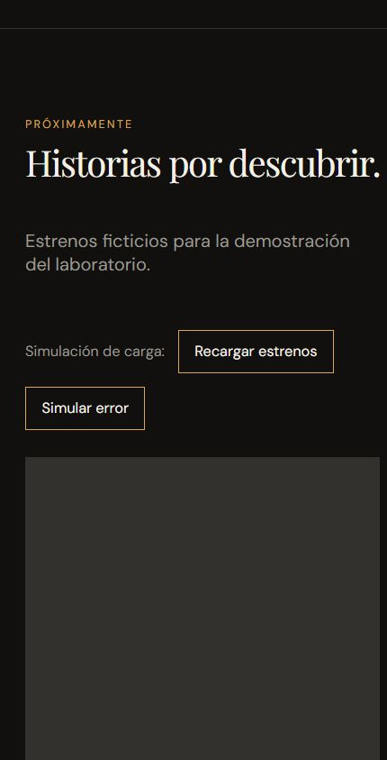
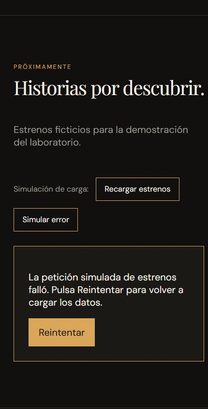

# Laboratorio 11 — Comunicación entre componentes en ReactJS

**Curso:** Desarrollo de Aplicaciones Empresariales  
**Docente:** Michael Montgomery Rosell  
**Periodo:** 2026-2 · **Semestre:** 4 · **Sección:** A · **Semana:** 11  
**Alumno(s):** [Completar nombres reales]  
**Fecha de entrega:** [Completar]

## 1. Diagnóstico del repositorio

La base ya incluía el adaptador, el aviso de favoritas, `useDebounce`, `useWindowSize`, el buscador controlado y la cartelera adaptable. `favoriteIds` ya estaba en `App`, pero faltaba derivar y enviar el total a `Header`. No existían el hook de estrenos, su esqueleto, el carrusel, la sección de estados ni la limpieza desde el banner. El README era el de la plantilla Vite.

Se creó la rama `lab11/puntos-7-11`. Se conservó el proyecto acumulativo y se organizaron los componentes en carpetas individuales. Los identificadores y comentarios del código están en inglés; los textos de interfaz y este entregable están en español.

## 2. Registro de responsabilidades

Completar según el trabajo real del equipo; no atribuir trabajo a integrantes sin confirmarlo.

| Alumno | Desarrollo | Evidencia y código |
| --- | --- | --- |
| [Completar] | Punto 7: petición simulada y ciclo de vida | `src/hooks/usePremieres.js` |
| [Completar] | Punto 8: carga, error y carrusel | Carpetas `PremiereSkeleton`, `PremieresCarousel`, `PremieresSection` |
| [Completar] | Punto 9: favoritas en la cabecera | `App.jsx`, `Header/Header.jsx` |
| [Completar] | Punto 10: limpiar filtro | `Hero/Hero.jsx`, `App.jsx`, `useDebounce.js` |
| [Completar] | Punto 11: documentación y verificación | Este entregable y `src/test/lab11.test.jsx` |

## 3. Desarrollo

### Punto 7 — Hook `usePremieres`

**Código:** [usePremieres.js](../src/hooks/usePremieres.js).

```js
const { premieres, status, error, reload } = usePremieres()
```

El hook encapsula una petición simulada mediante un temporizador de 1200 ms. Expone estados mutuamente excluyentes: `loading`, `success` y `error`. En éxito, adapta los datos locales con `adaptMovie`. `reload(true)` provoca un error reproducible y `reload()` vuelve a intentar con éxito. El error no es aleatorio: cualquier evaluador puede reproducirlo.

El efecto cancela el temporizador al desmontar el componente o sustituir una petición. Esto evita que una respuesta antigua sobrescriba una nueva y permite trabajar con el montaje de comprobación de `StrictMode`. Los estrenos son ficticios y no representan una cartelera real actualizada.

**Resultado:** carga inicial, datos adaptados, error explicativo y recuperación sin recargar toda la página.

### Punto 8 — Esqueleto, carrusel y sección

**Código:** [PremieresSection](../src/components/PremieresSection/PremieresSection.jsx), [PremiereSkeleton](../src/components/PremiereSkeleton/PremiereSkeleton.jsx), [PremieresCarousel](../src/components/PremieresCarousel/PremieresCarousel.jsx).

```jsx
{status === 'loading' && <PremiereSkeleton count={columns} />}
{status === 'success' && <PremieresCarousel premieres={premieres} columns={columns} />}
```

`PremieresSection` decide qué mostrar. El esqueleto anuncia la carga mediante `role="status"`; el contenedor usa `aria-busy`. En error se muestra una explicación con `role="alert"` y un botón **Reintentar**. El carrusel integra la biblioteca **Embla Carousel**: permite arrastrar, avanzar y retroceder con botones accesibles mediante teclado. No avanza automáticamente.

La sección comparte `useWindowSize` con `MovieList`: el carrusel presenta una tarjeta por debajo de 720 px, dos por debajo de 1000 px y tres desde 1000 px. La animación del esqueleto respeta la preferencia de movimiento reducido.

**Capturas reales del navegador:**






### Punto 9 — Contador compartido de favoritas

**Código:** [App.jsx](../src/App.jsx), [Header.jsx](../src/components/Header/Header.jsx).

```jsx
const [favoriteIds, setFavoriteIds] = useState([])
const favoriteCount = favoriteIds.length
// Inside the returned JSX:
<Header favoriteCount={favoriteCount} />
```

El contador es un **dato derivado**, no un segundo `useState`. Su origen es `favoriteIds` en `App`, el ancestro común de la cabecera y las tarjetas. `Header` recibe únicamente el número. Al filtrar, las favoritas ocultas siguen contando porque el total no depende de `filteredMovies`.

**¿Por qué el contador no puede vivir en la cabecera?**

La cabecera no es ancestro de `MovieList` ni de `MovieCard`: es su hermana dentro de `App`. Un estado local de `Header` no estaría disponible para las tarjetas mediante el flujo descendente de props. Mantener otro contador allí exigiría sincronizar copias y podría provocar diferencias entre corazones marcados y total mostrado. React renderiza la cabecera con el valor que su ancestro calcula; los eventos de las tarjetas llegan a ese ancestro mediante callbacks. La cabecera sí presenta el número, pero no debe ser propietaria de una fuente independiente de ese dato compartido en esta arquitectura.

### Punto 10 — Limpiar el filtro desde el banner

**Código:** [Hero.jsx](../src/components/Hero/Hero.jsx), [useDebounce.js](../src/hooks/useDebounce.js), [MovieSearch.jsx](../src/components/MovieSearch/MovieSearch.jsx).

```jsx
<Hero movie={movies[0]} hasFilter={searchTerm !== ''}
  onClearFilter={() => setSearchTerm('')} />
```

`searchTerm` vive en `App` porque lo necesitan el banner y el buscador. `MovieSearch` es controlado: recibe `value` y notifica cambios mediante `onChange`. El banner invoca `onClearFilter`, sin manipular el DOM del buscador. Vaciar el texto elimina inmediatamente el filtro; `useDebounce` descarta el valor anterior y limpia el temporizador pendiente para impedir que reaparezca una búsqueda antigua. El botón está deshabilitado cuando no hay filtro.

**Resultado:** el input se vacía, vuelven las ocho películas y se conservan las favoritas.

### Punto 11 — Árbol de componentes y datos

```text
App
│ Estado: favoriteIds, searchTerm, toast
│ Derivados: favoriteCount, debouncedSearchTerm, activeSearchTerm, filteredMovies
│ Datos estáticos: movies adaptadas (fuera del componente)
│ Acciones: toggleFavorite, setSearchTerm; efecto de cierre del aviso
├── Header
│   Prop: favoriteCount; sin lista de favoritas ni estado de negocio
├── main
│   ├── Hero
│   │   Props: movie, hasFilter, onClearFilter; sin copia del filtro
│   │   └── Button × 2: enlace de horarios y limpieza
│   ├── MovieList
│   │   Props: movies filtradas, favoriteIds, onToggleFavorite,
│   │          searchTerm, onSearchChange
│   │   Hook local: useWindowSize → width/height; derivado: columns
│   │   ├── MovieSearch
│   │   │   Props: value, onChange; input controlado, sin estado duplicado
│   │   └── MovieCard × N
│   │       Props: movie, isFavorite, onToggleFavorite
│   │       └── Button: emite el id; no conoce cómo se muestra el aviso
│   └── PremieresSection
│       Hooks locales: usePremieres y useWindowSize
│       Estado del hook: status, premieres, error, request
│       Acción: reload; derivado: columns
│       ├── Button × 2: recargar y simular error
│       ├── PremiereSkeleton [loading]
│       │   Prop: count; sin estado
│       ├── mensaje de error + Button de reintento [error]
│       └── PremieresCarousel [success]
│           Props: premieres, columns
│           Estado interno de Embla: posición y geometría del carrusel
│           ├── Button × 2: anterior y siguiente
│           └── article × N: datos de cada estreno
├── div[role=status]: aviso de favoritas a partir de toast
└── Footer: información estática y año al cargar el módulo
```

No se eleva todo a `App`: la petición y sus errores pertenecen únicamente a `PremieresSection`; el desplazamiento pertenece al carrusel. Solo se comparten en la raíz los datos requeridos por ramas hermanas.

## 4. Observaciones sobre los hooks

| Hook | Lógica extraída | Consumidores |
| --- | --- | --- |
| `useDebounce` | Retardo de búsqueda, descarte del valor al vaciar y limpieza del temporizador | `App`, para la búsqueda controlada |
| `useWindowSize` | Tamaño de ventana y alta/baja del listener `resize` | `MovieList` y `PremieresSection` |
| `usePremieres` | Ciclo de petición simulada, adaptación, fallo, recarga y cancelación | `PremieresSection` |

Compartir un hook reutiliza lógica, no una instancia global de estado: las dos llamadas a `useWindowSize` son independientes. El hook de estrenos se utiliza una sola vez porque esa carga pertenece a una sola sección.

## 5. Casos de prueba y evidencia de ejecución

Automatización: [lab11.test.jsx](../src/test/lab11.test.jsx), con Vitest y React Testing Library. Las pruebas del DOM usan sustitutos de los observadores del navegador; la navegación real de Embla se verificó además en Chromium.

| Caso | Procedimiento | Resultado verificado |
| --- | --- | --- |
| 1 | Montar el hook, completar demora, provocar fallo y reintentar | `loading → success → loading → error → loading → success`; datos adaptados |
| 2 | Sustituir una petición antes de terminar y desmontar | No se publica el fallo anterior; no quedan temporizadores |
| 3 | Montar la sección y usar los botones de simulación | Se muestran esqueleto, carrusel, alerta y recuperación |
| 4 | Marcar Duna, buscar otra película, limpiar y desmarcar | Total `0 → 1 → 1 → 0`, incluso al ocultar la favorita |
| 5 | Buscar Duna, escribir otro texto y limpiar antes de 300 ms | Input vacío y ocho películas inmediatamente y tras vencer el retardo; búsqueda sin coincidencias muestra su mensaje |

Verificaciones ejecutadas: `npm test` (5 pruebas), `npm run lint` y `npm run build`. En navegador de 360 px se comprobó que no había desbordamiento horizontal, que **Siguiente** cambiaba la posición real del carrusel y que **Simular error → Reintentar** recuperaba la sección.

### Evidencia que debe completar el equipo

- Nombres, fecha y distribución real del trabajo.
- Captura de la estructura del proyecto abierta en el editor, incluyendo `components`, `hooks`, `data`, `test` y `docs`.
- Capturas adicionales de favoritas y buscador para acompañar los puntos 9 y 10.
- Publicación de la rama revisada en el repositorio del equipo y entrega del documento en el campus virtual (punto 12).

Las capturas incluidas son de la aplicación ejecutada; los elementos anteriores pendientes no se presentan como ya realizados.

## 6. Conclusiones

1. Elevar el estado al ancestro común permite comunicar el banner, el buscador, las tarjetas y la cabecera con props y callbacks, sin manipular directamente otros componentes.
2. Derivar el contador de la lista de identificadores evita estados redundantes y conserva el total al filtrar la cartelera.
3. Los hooks separan la lógica temporal de la presentación. La limpieza de efectos evita respuestas obsoletas y búsquedas que reaparecen después de limpiar.
4. Una sección asíncrona debe comunicar tanto la espera como el error y ofrecer recuperación. El carrusel y el esqueleto son componentes de presentación reutilizables.
5. La reutilización de `useWindowSize` en dos componentes demuestra que se puede compartir lógica sin trasladar todos los datos a la raíz.
